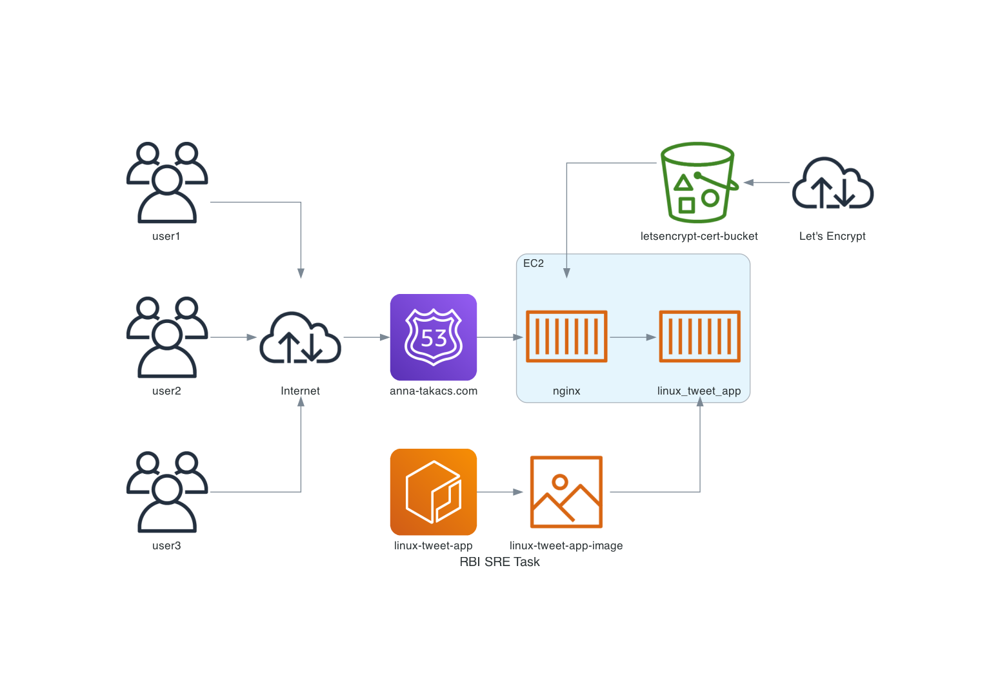

# RBI SRE Task

## Table of Contents
1. [Introduction](#introduction)
2. [Architecture Overview](#architecture-overview)
3. [Detailed Components Description](#detailed-components-description)
4. [Deployment Process](#deployment-process)
5. [Pipeline](#pipeline)
6. [Tool Decisions](#tool-decisions)

## Introduction
**Project Name**: RBI SRE Task 

**Description**: This documentation provides an overview of the RBI SRE Task, including build, deployment and configuration.

## Architecture Overview
**Diagram**: 
**Components**:
- **NGINX**: NGINX handling both HTTP and HTTPS requests.
- **Linux Tweet App**: A simple NGINX website that allows a user to send a tweet.

## Detailed Components Description
### Servers
- **NGINX**
  - NGINX webserver that listens both on port 80 and 443 and directs incoming requests to the Linux Tweet App.
  - It redirects all HTTP requests to HTTPS.
  - This webserver uses a custom SSL cert provided by Let's Encrypt.
- **Application Server**
  - It is a simple NGINX server that serves the static frontend files of the website.
### Computing
- **EC2**
  - **Instance type**: t3.micro
  - **IP address**: 16.170.206.73
  - **Installed agents**: docker, docker-compose
- **Firewall**: Configured to allow traffic on ports 80 and 443.
### Routing
- **Route53**
  - **Zone**: anna-takacs.com
  - **Type**: Public Hosted Zone
  - **Owner**: annaa.takacs@gmail.com
### Registry
- **ECR**
  - Private Registry
  - Access granted for Github Actions via OIDC and custom IAM role
### Storage
- **S3**
  - **letsencrypt-cert-buckets**:
    - Standard storage class
    - Public access blocked
    - It's purpose is to store the SSL certificates provided by Let's Encrypt
  - **anna-tfstates**:
    - Standard storage class
    - Public access blocked
    - This bucket serves as the remote state backend of Terraform

## Deployment Process
### Tools
- **Terraform** for provisioning AWS Cloud resources 
- **Docker** for containerization of the web apps
- **Docker-compose** for managing the deployment of multi-container Docker applications
- **Github Actions** for automating the full CI/CD process
### Steps
1. Clone the repository.
2. Configure the following pipeline secrets:
    - AWS_GITHUB_ACTION_ROLE: IAM role with ECR and Route53
    - REPO_NAME: Name of the ECR repo
    - SSH_PRIVATE_KEY: Private key used in 
    - USERNAME: Name of the user used for the SSH connection
    - HOST: Public IP address of the EC2 host
3. Run the pipeline

## Pipeline
### Jobs
1. **iac-security-scanning**: Checkov scanner is run to detect vulnerabilities in the IaC.
2. **iac**: The necessary Cloud infrastructure is provisioned with terraform.
3. **build**: The linux-tweet-app docker image is built and uploaded to ECR.
4. **docker-compose**: 
    - The pipeline copies the necessary `docker-compose.yml` and config files.
    - It pulls the Let's Encrypt certs from the S3 bucket.
    - The `deploy-apps.sh` script modifies the config files accordingly and it starts the continer with docker-compose.

## Tool Decisions
1. **Terraform**: The most powerful and most commonly used IaC tool for provisioning Cloud resources. It is a cloud agnostic infrastructure automation tool.
2. **Docker**: Applications that were built with Docker are more consistent as they encapsulate the entire application environment, therefore they run consistently on a multitude of platforms. They can be version-controlled and easily uploaded to ECR.
3. **Docker compose**: Since there are multiple docker containers in this solution, docker-compose orchestrates the deployment of management of these containers. All configuration is stored in the `docker-compose.yml`.
4. **Github Actions**: Github Actions can be used immediatley, without the need to configure/install any pipeline servers or workers. It integrates seamlessly with AWS via OIDC.
